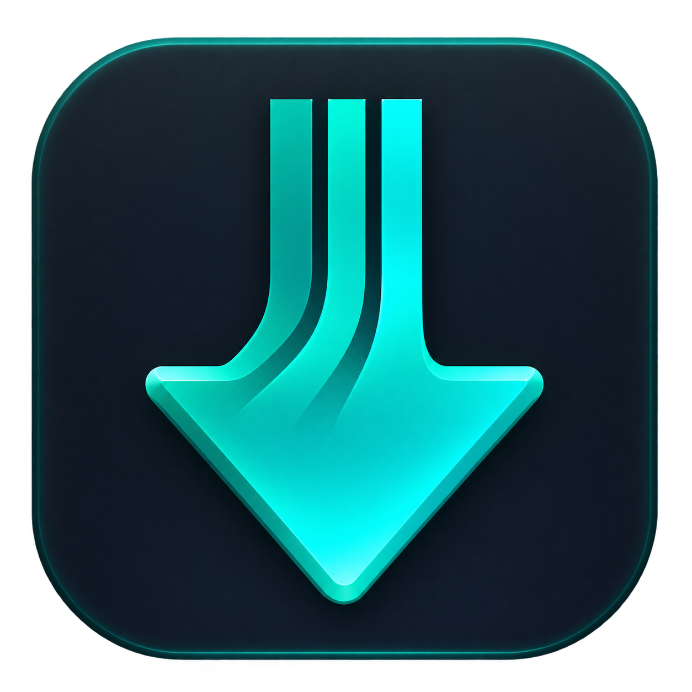

# FluxGet



FluxGet is a download manager written in Go. It helps you manage several downloads, control their speed, and continue saved downloads after an interruption when the server allows it.

**Version 2.0.2 is available for 64-bit Windows and Debian/Ubuntu.** It fixes Chrome handoffs, cancellation, Ctrl-click browser controls and duplicate-download choices. Both installers passed native verification. Chrome has hands-on Windows evidence. Firefox, Opera and other Linux distributions still need native testing. [Download FluxGet v2.0.2](https://github.com/Parsania80/FluxGet/releases/tag/v2.0.2)

**[Version 2.0.0](https://github.com/Parsania80/FluxGet/releases/tag/v2.0.0)** introduced YouTube videos and playlists, per-download proxy routing, and automatic file-type folders. Version 2.0.1 adds guided browser setup, a first-use YouTube tools prompt, and a saved appearance choice. The [releases page](https://github.com/Parsania80/FluxGet/releases) lists published Windows and Linux installers.

## What you can do

- Add a direct HTTP or HTTPS file link and download now or later.
- Pause, resume, retry, and manage several downloads in one list.
- See each download's speed, progress, and individual file parts.
- Set speed limits and remove a custom limit with one click.
- Select several downloads for shared actions or confirmed file deletion.
- Let Automatic mode adjust downloads and connections within your limits.

Automatic starts with one connection and may keep using one. If a server cannot provide safely validated file parts, FluxGet uses a single stream. Even when a server supports file parts, FluxGet must check that they all belong to the same file version.

On Linux, Automatic also watches CPU, memory, and storage pressure and reduces work when needed. Manual controls are available in Settings. A Chrome browser-integration preview is available. Firefox and Opera packages are prepared but still need native testing. Using Wi-Fi and Ethernet together is planned.

## Install a release

Get the package for your system from [GitHub Releases](https://github.com/Parsania80/FluxGet/releases).

- **Windows:** Open `fluxget-2.0.2-windows-amd64-setup.exe` and follow the setup wizard. Open FluxGet from its new shortcut. Use NTFS for downloads and saved progress.
- **Debian/Ubuntu Linux:** Run `sudo dpkg -i fluxget_2.0.2_amd64.deb`, then open FluxGet from the applications menu. If dependencies are missing, `sudo apt install ./fluxget_2.0.2_amd64.deb` installs them too.

Both installers include the app, engine, browser hosts, and extension folders. See the release notes for system requirements and testing limits.

To set up browser downloads, open **Settings → Browser downloads → Set up browser extension**. After upgrading, use **Reload** on the FluxGet card in `chrome://extensions` and refresh download pages.

## Build and open the desktop app

You need **Go 1.26.8 or later**, a C compiler, and the Linux graphics development libraries required by [Fyne](https://docs.fyne.io/started/quick/).

From the repository folder:

```bash
mkdir -p dist
go build -o dist/fluxget .
(cd desktop && go build -o ../dist/fluxget-gui .)
./dist/fluxget-gui
```

Keep `fluxget` and `fluxget-gui` together in the same folder.

To change the app's theme, open **Settings → General → Appearance**, choose **Follow system**, **Light**, or **Dark**, and click **Save settings**. FluxGet applies the choice immediately and remembers it when you reopen the app.

## Download a file

1. Choose **Add download** and paste a direct file link.
2. Choose a folder and filename if needed.
3. Select **Download now**, or **Download later** to leave it paused.
4. Select a download to pause, resume, retry, or open its folder.

Extra downloads wait for a free slot. After reopening FluxGet, unfinished downloads stay paused until you resume them.

Use **Settings → General** for the download folder, display units and speed limits. Sizes and speeds use **MB** by default; you can choose **KB**, **MB**, or **GB**. Open **Settings → Connections** to set download/connection limits or switch between Automatic and Manual; advanced connection budgets stay collapsed. **Save settings** stays visible while you scroll. The locally installed preview includes the refreshed Downloads and Settings screens. Browser integration has its own **Browser downloads** section and **Save browser settings** button.

Select a row to show its actions, or use checkboxes for a group. The bottom bar keeps selection and removal controls visible. Filenames have their own line above speed and route controls.

Removing an item from the list keeps its files. Deleting files is a separate action that requires confirmation.

### Sort downloads into folders

Version 2 builds automatically sort new downloads inside your chosen download folder: **Music**, **Videos**, **Pictures**, **Documents**, **Archives**, **Programs** and **Other**. For example, `song.mp3` goes into `Downloads/Music` and `report.pdf` into `Downloads/Documents`. Unknown extensions go into Other.

Use **Settings → General → Sort new downloads into file-type folders** to change the default, then **Save settings**. You can also turn sorting off for an individual download in Add download, the browser confirmation or the YouTube output settings. Automatic browser capture uses the saved default. YouTube audio goes into Music and video into Videos; playlist filenames keep their order numbers. Sorting follows the final filename extension, including a safe filename supplied by an HTTP server.

Sorting starts enabled when settings have no previous preference. Existing queued or downloaded files stay in place, and existing files are never silently overwritten. This is a v2 feature; the published v1.0.0 release does not include it.

## Download through a proxy

Included in v2 builds; not included in v1.0.0.

In **Settings → Proxy**, enter the listening address from v2ray or another proxy app, such as `socks5://127.0.0.1:10808` or `http://127.0.0.1:10809`. Use your app's actual port and keep it running. HTTP, HTTPS and SOCKS5 addresses without a username/password are supported; subscription, vmess and vless links are not proxy addresses.

Choose **Use proxy by default for new downloads** and click **Save settings**, or leave the default off and check **Download with proxy** when adding just one file. Each download has a **Proxy** or **Direct** button. Pause it before changing that choice, apply, then resume. Turning the option off uses Direct; changing the default does not reroute existing downloads.

A failed proxy reports an error and never falls back to Direct automatically. YouTube pages and media files use different servers, and your browser may route requests differently from FluxGet. A media timeout alone does not prove your proxy is broken; compare the configured route and media-tool behavior before choosing a fix. Trying another proxy server is one troubleshooting step. SOCKS5 sends destination names to the proxy for DNS resolution. Direct ignores proxy environment variables and uses the operating system's normal network route. The YouTube tab can use the same configured proxy for analysis and downloading; the command line also accepts `-proxy`.

## YouTube preview

Included in v2 builds; not included in v1.0.0.

In the updated source builds, paste a YouTube link and choose **Analyze**. If tools are missing, choose **Install** to set them up and continue analyzing the same link, or **Later** to defer setup. FluxGet downloads pinned yt-dlp, Deno and FFmpeg tools from their upstream releases and verifies SHA-256 checksums. Setup uses the YouTube tab's selected connection, requires internet access and about 700 MB of free space, and can be canceled. For manual setup or to select an existing `tools.json`, open **Media tools**. See [tool notices](packaging/MEDIA-TOOLS-NOTICES.md).

Paste a public video or Shorts link and choose **Analyze**. Choose **Video** or **Audio only**, format, quality, folder and filename, then **Download**. For a finite playlist, choose **Choose from playlist**, select entries and add them to Downloads. Use the usual pause, resume, cancel and speed controls. Existing files are kept. Unfinished jobs reopen paused; damaged or unverified saved media and rejected saved ranges may require **Restart media from beginning**. Transfers have network timeouts but no fixed 30-minute transfer cutoff.

Public MP3 conversion, a 720p video/audio merge and a four-entry playlist passed on Linux. Media/proxy and desktop-control checks passed on native Linux and Windows. The v2 release additionally requires first-use tool setup and media assembly checks from both installed packages. Broader long-duration and storage-pressure acceptance remains open; this release does not claim universal YouTube availability.

The installed Linux single-video preview was approved by the operator on 2026-11-13; its hands-on preview review is done. Remaining acceptance work includes native Windows desktop checks, a fresh run of the current branch and broader recovery testing; normal-playlist selection is installed locally and was approved by the operator on 2026-11-13. All four entries of a public sample playlist completed as M4A through an isolated persistent queue, with no failures. Stage-5 testing is underway: isolated Linux checks cover interrupted processing, refreshed links, full disk, mixed-download speed limits, one-hour media and bounded CPU/memory pressure. Extended wall-clock/storage and native/public checks remain open.

The local Linux preview was refreshed with stage-4 playlist selection on 2026-11-13, including matching engine/desktop binaries and the existing pinned media tools. Installed-engine tests passed playlist admission, crash/reopen replay, MP4 merging and MP3 conversion with temporary local fixtures.

The refreshed YouTube workspace is installed locally. It keeps the video list beside output settings, with Download always visible. Use **Browse** to choose a playlist destination. MP3 bitrate and lower-quality approval appear when needed; changing output settings clears the previous format review. **Connection** shows the configured source route.

For playlists in the installed Linux preview, choose **Choose from playlist**, then **Analyze**. Select entries across pages, choose your preferred output and folder, then **Load selected formats**. Review skipped items and approve any lower qualities before clicking **Download**. Each video appears separately in Downloads; retry only failed items. Pages contain 100 entries, with up to 1,000 selected per batch. Existing files are kept, and larger metadata or a full queue can require a smaller batch.

YouTube **Mixes** (`list=RD…`) are not supported by playlist import in this preview. Choose **This video** to download the current item from the same link. To import a fixed selection, add the wanted videos to a regular public or unlisted playlist and use that playlist link; saving a Mix to your library does not change this limitation. Mix import is outside the approved scope.

## Browser downloads

FluxGet installers include browser extension files and register the Chrome and Firefox hosts. Go to **Settings → Browser downloads → Set up browser extension** and choose your browser. Use **Copy folder path** to paste the preinstalled location into the browser's file picker, or **Open extension folder** to browse the files. Chrome requires you to load this development extension from its extensions page and approve access.

For Chrome, turn on **Developer mode** and choose **Load unpacked**. In **Browser downloads**, enable integration and your browser, then save. Open FluxGet from the browser toolbar, turn on **Enable this browser profile**, and choose **Test connection**. The desktop's **Connected profiles** list shows where you enabled the extension. **Disconnect all profiles** stops new handoffs until each profile opts in again. See [browser setup](extensions/README.md) for manual setup and source-build instructions.

Choose **Download automatically** for capture, or **Ask before downloading** to confirm each file. Approve website access once when enabling the profile, or choose **Enable capture for all websites** in the popup. Reload the page before retrying. New websites need no separate setup; the same capture rules apply across websites, with no special handling for individual download sites. To keep downloads from certain hosts in your browser, add them to **Settings → Browser downloads → Excluded hosts**; subdomains are included. You can disable capture globally, per browser/profile, or temporarily. You can also right-click a public link and choose **Send link to FluxGet**.

Use a normal left-click to download with FluxGet. Hold **Ctrl + left-click** to keep that download in your browser; the browser's usual Ctrl-click navigation still applies. When an update adds shortcut permissions, finish capture setup once and reload the website. Chrome may briefly show a download during handoff; its canceled history entry is removed after FluxGet confirms ownership. Existing unrelated history is kept.

Chrome capture, query-string/CDN redirects and browser fallback have native test evidence, including hands-on Windows capture and duplicate handling. Firefox Snap and Opera still need native verification. Firefox temporary extensions disappear after browser restart; permanent installation needs a signed add-on. Windows setup does not register Opera yet. Logins, POST downloads, private browsing and uncertain requests stay in the browser. If capture is skipped, its reason appears near the top of the popup.

After replacing an unpacked Chrome extension, click **Reload** on its card at `chrome://extensions`, then refresh the actual download website with **Ctrl+F5**. An old page script can report **Extension context invalidated** after an extension reload. The updated script releases stale handlers cleanly. Ctrl + left-click gives Chrome control of the download, including its Pause and Cancel buttons. The popup shows why a transfer stayed in Chrome.

Windows live verification on 2026-11-16 confirmed Chrome can pause and cancel downloads started with Ctrl + left-click after the updated page handler loaded.

**Test connection** shows its result below the button. It checks whether FluxGet responds to the extension. The latest download result appears near the top of the popup and identifies cookie, authorization or byte-range restrictions when they apply. For a file that the server offers without a browser session, **Send link to FluxGet** starts a separate request from the original link.

For common direct file links such as `.rar`, `.zip` and `.exe`, the updated extension opens FluxGet's approval popup before Chrome starts a transfer. Choosing **Use FluxGet** sends the link directly to the app. Choosing **Use browser** starts the original Chrome download. Ctrl + left-click also uses Chrome. Existing Chrome history entries belong to earlier transfers.

For downloads first detected in Chrome, the extension checks access without cookies and compares file metadata when cookies were present. A successful check opens the FluxGet prompt. If the server requires a browser session or cannot provide matching metadata, Chrome keeps the transfer.

In **Ask before downloading** mode, the updated desktop opens a separate **Download with FluxGet?** window above other windows. Choose **Use FluxGet** to approve or **Use browser** to continue in Chrome. Closing the window cancels the request. If Chrome had already started the transfer, FluxGet cancels that exact transfer and removes its canceled history entry.

Reloading the extension refreshes its click handler on open pages with website access. The handler catches common file links before document click handlers can start a browser transfer. After installing this preview, reload FluxGet at `chrome://extensions` and refresh the download page once. Chrome retains old extension errors until you clear them; report any new error after clearing the list.

Windows verification on 2026-11-16 confirmed that a normal file click opens the FluxGet prompt and closing it cancels without creating a new Chrome download. The local extension trace confirms direct-link capture, cancellation and no pending handoffs.

If a browser link is already downloading in FluxGet or its filename is in use, FluxGet opens **Download already exists**. Choose **Continue existing download**, **Save another copy**, or **Keep existing file**. **Replace existing file…** is available when a finished file exists and asks for confirmation; it keeps the original until the replacement finishes successfully. Canceling or encountering a conflict after choosing FluxGet does not start Chrome. Continuing the existing download was verified on Windows on 2026-11-16.

## Use the command line

Build the CLI with `go build -o dist/fluxget .`, then run:

```bash
./dist/fluxget -url "https://example.com/file.zip"
```

Replace the example link with a direct file URL. Files go to your Downloads folder unless you choose another location:

```bash
./dist/fluxget -url "https://example.com/file.zip" -out "/path/to/file.zip"
./dist/fluxget -resume -out "/path/to/file.zip"
./dist/fluxget -h
```

Resume uses the same output path and requires a valid saved checkpoint. The standalone CLI uses Manual concurrency by default.

## Before you use it

- Intended for public direct links. Website logins and authenticated browser downloads are not supported.
- Resume depends on the saved data and server response; some downloads need a fresh start.
- New downloads refuse existing output files. Incomplete data is kept after failures; final publication requires filesystem hard-link support.
- Download metadata saves complete source URLs, including CDN query parameters. These links may grant access or expire; keep metadata private. Diagnostic messages hide URLs. Expired links may require a fresh download link.
- Power-loss recovery is not guaranteed. Broader interactive desktop and browser acceptance are still in progress.

## Development

Development uses `main`. The `v2.0.2` tag triggers native Windows/Linux tests, installer verification and publication of both installers with checksums. Branch pushes run CI without publishing. Earlier release tags and assets remain preserved.

The engine and desktop are separate Go modules. Run checks in both:

```bash
go test -race ./... && go vet ./...
(cd desktop && go test -race ./... && go vet ./...)
```

See [project.md](project.md) for architecture, technical details, and next steps; [BENCHMARKS.md](BENCHMARKS.md) for recorded measurements; and [SESSION-LOG.md](SESSION-LOG.md) for development history.

## License

[MIT](LICENSE).
