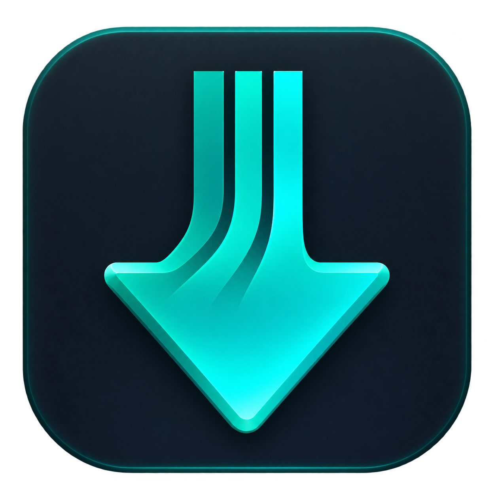

# FluxGet



FluxGet is a download manager written in Go. It helps you manage several downloads, control their speed, and continue saved downloads after an interruption when the server allows it.

**[Version 1.0.0 is available for Linux and Windows (64-bit Intel/AMD).](https://github.com/Parsania80/FluxGet/releases/tag/v1.0.0)** Native checks and installer verification passed on both operating systems. Release packages are built only when a version tag such as `v1.0.0` is pushed. Branch pushes run checks without publishing packages. Windows browser capture and other Linux distributions still need hands-on testing. macOS is not included.

**In development for the next version:** YouTube video and playlist downloads with quality and format choices. Development builds can download a single YouTube video or audio track from the YouTube tab into the Downloads list. The locally installed Linux preview also supports selecting playlist entries; the normal-playlist preview was approved by the operator on 2026-11-13. Public MP3 conversion, a 720p video/audio merge and all four entries of a sample playlist passed through a proxy. Windows desktop acceptance remains open. See the [YouTube roadmap](project.md#youtube-videos-and-playlists--next-release-plan).

## What you can do

- Add a direct HTTP or HTTPS file link and download now or later.
- Pause, resume, retry, and manage several downloads in one list.
- See each download's speed, progress, and individual file parts.
- Set speed limits and remove a custom limit with one click.
- Select several downloads for shared actions or confirmed file deletion.
- Let Automatic mode adjust downloads and connections within your limits.

Automatic starts with one connection and may keep using one. If a server cannot provide safely validated file parts, FluxGet uses a single stream. Even when a server supports file parts, FluxGet must check that they all belong to the same file version.

On Linux, Automatic also watches CPU, memory, and storage pressure and reduces work when needed. Manual controls are available in Settings. A Chrome browser-integration preview is available. Firefox and Opera packages are prepared but still need native testing. Using Wi-Fi and Ethernet together is planned.

## Install a release

Get the package for your system from [GitHub Releases](https://github.com/Parsania80/FluxGet/releases).

- **Windows:** Open `fluxget-1.0.0-windows-amd64-setup.exe` and follow the setup wizard. Open FluxGet from its new shortcut. Use NTFS for downloads and saved progress.
- **Debian/Ubuntu Linux:** Run `sudo dpkg -i fluxget_1.0.0_amd64.deb`, then open FluxGet from the applications menu. If dependencies are missing, `sudo apt install ./fluxget_1.0.0_amd64.deb` installs them too.

Both installers include the app, engine, browser hosts, and extension folders. See the release notes for system requirements and testing limits.

## Build and open the desktop app

You need **Go 1.26.8 or later**, a C compiler, and the Linux graphics development libraries required by [Fyne](https://docs.fyne.io/started/quick/).

From the repository folder:

```bash
mkdir -p dist
go build -o dist/fluxget .
(cd desktop && go build -o ../dist/fluxget-gui .)
./dist/fluxget-gui
```

Keep `fluxget` and `fluxget-gui` together in the same folder.

## Download a file

1. Choose **Add download** and paste a direct file link.
2. Choose a folder and filename if needed.
3. Select **Download now**, or **Download later** to leave it paused.
4. Select a download to pause, resume, retry, or open its folder.

Extra downloads wait for a free slot. After reopening FluxGet, unfinished downloads stay paused until you resume them.

Use **Settings → General** for the download folder, display units and speed limits. Sizes and speeds use **MB** by default; you can choose **KB**, **MB**, or **GB**. Open **Settings → Connections** to set download/connection limits or switch between Automatic and Manual; advanced connection budgets stay collapsed. **Save settings** stays visible while you scroll. The locally installed preview includes the refreshed Downloads and Settings screens. Browser integration has its own **Browser downloads** section and **Save browser settings** button.

Select a row to show its actions, or use checkboxes for a group. The bottom bar keeps selection and removal controls visible. Filenames have their own line above speed and route controls.

Removing an item from the list keeps its files. Deleting files is a separate action that requires confirmation.

### Sort downloads into folders

New development builds automatically sort new downloads inside your chosen download folder: **Music**, **Videos**, **Pictures**, **Documents**, **Archives**, **Programs** and **Other**. For example, `song.mp3` goes into `Downloads/Music` and `report.pdf` into `Downloads/Documents`. Unknown extensions go into Other.

Use **Settings → General → Sort new downloads into file-type folders** to change the default, then **Save settings**. You can also turn sorting off for an individual download in Add download, the browser confirmation or the YouTube output settings. Automatic browser capture uses the saved default. YouTube audio goes into Music and video into Videos; playlist filenames keep their order numbers. Sorting follows the final filename extension, including a safe filename supplied by an HTTP server.

Sorting starts enabled when settings have no previous preference. Existing queued or downloaded files stay in place, and existing files are never silently overwritten. The paired Linux preview now includes this feature; it remains outside the published v1.0.0 release.

## Download through a proxy

Available in development builds; not included in v1.0.0.

In **Settings → Proxy**, enter the listening address from v2ray or another proxy app, such as `socks5://127.0.0.1:10808` or `http://127.0.0.1:10809`. Use your app's actual port and keep it running. HTTP, HTTPS and SOCKS5 addresses without a username/password are supported; subscription, vmess and vless links are not proxy addresses.

Choose **Use proxy by default for new downloads** and click **Save settings**, or leave the default off and check **Download with proxy** when adding just one file. Each download has a **Proxy** or **Direct** button. Pause it before changing that choice, apply, then resume. Turning the option off uses Direct; changing the default does not reroute existing downloads.

A failed proxy reports an error and never falls back to Direct automatically. YouTube pages and media files use different servers, and your browser may route requests differently from FluxGet. A media timeout alone does not prove your proxy is broken; compare the configured route and media-tool behavior before choosing a fix. Trying another proxy server is one troubleshooting step. SOCKS5 sends destination names to the proxy for DNS resolution. Direct ignores proxy environment variables and uses the operating system's normal network route. The YouTube tab can use the same configured proxy for analysis and downloading; its development command also accepts `-proxy`.

## YouTube preview

Available in development builds; not included in v1.0.0.

Open **YouTube**, paste a public video or Shorts link, and choose **Analyze**. You can cancel analysis or use your configured proxy. Choose **Video** or **Audio only**, an available format and quality, then a folder and filename. Click **Download** to start it in the Downloads list. Use the usual pause, resume and speed controls there. Unfinished jobs reopen paused; damaged or unverified saved media may require **Restart media from beginning**. A rejected saved download range (HTTP 416) can also require an explicit restart; the development source now explains this error. The development source also removes the fixed 30-minute transfer cutoff while keeping pause/cancel and network timeouts. These updates are included in the paired Linux preview installed on 2026-11-13. The locally installed Linux preview also supports selecting playlist entries; the normal-playlist preview was approved by the operator on 2026-11-13.

The locally installed preview includes the prepared media tools beside the app. Other development builds need these tools configured. If they are not configured, open **Media tools** and choose their `tools.json` manifest. See the [development setup and roadmap](project.md#youtube-videos-and-playlists--next-release-plan). A full public audio-to-MP3 download passed on Linux. A public 720p video/audio merge also passed full decoding. The media baseline passed native Linux/Windows media/proxy and desktop-control checks in [CI run 43481879691](https://github.com/Parsania80/FluxGet/actions/runs/43481879691) and was merged into main. Subsequent folder-sorting changes still need native Windows CI.

The installed Linux single-video preview was approved by the operator on 2026-11-13; its hands-on preview review is done. Remaining acceptance work includes native Windows desktop checks, a fresh run of the current branch and broader recovery testing; normal-playlist selection is installed locally and was approved by the operator on 2026-11-13. All four entries of a public sample playlist completed as M4A through an isolated persistent queue, with no failures. Stage-5 testing is underway: isolated Linux checks cover interrupted processing, refreshed links, full disk, mixed-download speed limits, one-hour media and bounded CPU/memory pressure. Extended wall-clock/storage and native/public checks remain open.

The local Linux preview was refreshed with stage-4 playlist selection on 2026-11-13, including matching engine/desktop binaries and the existing pinned media tools. Installed-engine tests passed playlist admission, crash/reopen replay, MP4 merging and MP3 conversion with temporary local fixtures.

The refreshed YouTube workspace is installed locally. It keeps the video list beside output settings, with Download always visible. Use **Browse** to choose a playlist destination. MP3 bitrate and lower-quality approval appear when needed; changing output settings clears the previous format review. **Connection** shows the configured source route.

For playlists in the installed Linux preview, choose **Choose from playlist**, then **Analyze**. Select entries across pages, choose your preferred output and folder, then **Load selected formats**. Review skipped items and approve any lower qualities before clicking **Download**. Each video appears separately in Downloads; retry only failed items. Pages contain 100 entries, with up to 1,000 selected per batch. Existing files are kept, and larger metadata or a full queue can require a smaller batch.

YouTube **Mixes** (`list=RD…`) are not supported by playlist import in this preview. Choose **This video** to download the current item from the same link. To import a fixed selection, add the wanted videos to a regular public or unlisted playlist and use that playlist link; saving a Mix to your library does not change this limitation. Mix import is outside the approved scope.

## Browser downloads

Browser setup currently uses a development extension. The recommended release setup is a normal FluxGet installer that configures the local bridge and guides you through connecting your browser; end users should not need Developer mode or folder selection. The v1 installers install the app and register Chrome/Firefox hosts; store distribution and the browser connection wizard are still pending.

See [browser setup](extensions/README.md) to build/register the bridge and load the extension. Open `chrome://extensions`, turn on Developer mode, and **Load unpacked** from the installed `extensions/chrome` folder. With the Linux `.deb` this is `/opt/fluxget/extensions/chrome`; on Windows it is `%LOCALAPPDATA%\Programs\FluxGet\extensions\chrome`. Select the folder itself. In FluxGet **Settings → Browser downloads**, enable integration and your browser. Then enable your profile in the extension popup.

Choose **Download automatically** for capture, or **Ask before downloading** to confirm each file. Approve website access once when enabling the profile, or choose **Enable capture for all websites** in the popup. Reload the page before retrying. New websites need no separate setup; the same capture rules apply across websites, with no special handling for individual download sites. To keep downloads from certain hosts in your browser, add them to **Settings → Browser downloads → Excluded hosts**; subdomains are included. You can disable capture globally, per browser/profile, or temporarily. You can also right-click a public link and choose **Send link to FluxGet**.

Use a normal left-click to download with FluxGet. Hold **Ctrl + left-click** to keep that download in your browser; the browser's usual Ctrl-click navigation still applies. When an update adds shortcut permissions, finish capture setup once and reload the website. Chrome may briefly show a download during handoff; its canceled history entry is removed after FluxGet confirms ownership. Existing unrelated history is kept.

Chrome capture, query-string/CDN redirects and browser fallback have passed a native test. Windows capture, Firefox Snap and Opera still need native verification. Firefox temporary extensions disappear after browser restart; permanent installation needs a signed add-on. Windows setup does not register Opera yet. Logins, POST downloads, private browsing and uncertain requests stay in the browser. If capture is skipped, its reason appears near the top of the popup.

## Use the command line

Build the CLI with `go build -o dist/fluxget .`, then run:

```bash
./dist/fluxget -url "https://example.com/file.zip"
```

Replace the example link with a direct file URL. Files go to your Downloads folder unless you choose another location:

```bash
./dist/fluxget -url "https://example.com/file.zip" -out "/path/to/file.zip"
./dist/fluxget -resume -out "/path/to/file.zip"
./dist/fluxget -h
```

Resume uses the same output path and requires a valid saved checkpoint. The standalone CLI uses Manual concurrency by default.

## Before you use it

- Intended for public direct links. Website logins and authenticated browser downloads are not supported.
- Resume depends on the saved data and server response; some downloads need a fresh start.
- New downloads refuse existing output files. Incomplete data is kept after failures; final publication requires filesystem hard-link support.
- Download metadata saves complete source URLs, including CDN query parameters. These links may grant access or expire; keep metadata private. Diagnostic messages hide URLs. Expired links may require a fresh download link.
- Power-loss recovery is not guaranteed. Broader interactive desktop and browser acceptance are still in progress.

## Development

New development uses `main`; the passing media-acceptance branch has been merged. File-type folder sorting is installed in the local Linux preview and passed isolated installed-engine checks. The feature branch `codex/file-type-folders` is ready to publish through GitHub Desktop; branch pushes run Linux and Windows CI, including sorting, queue recovery and preference checks. Native Windows results remain pending. The first release is preserved as tag `v1.0.0`. Only version tags publish installers.

The engine and desktop are separate Go modules. Run checks in both:

```bash
go test -race ./... && go vet ./...
(cd desktop && go test -race ./... && go vet ./...)
```

See [project.md](project.md) for architecture, technical details, and next steps; [BENCHMARKS.md](BENCHMARKS.md) for recorded measurements; and [SESSION-LOG.md](SESSION-LOG.md) for development history.

## License

[MIT](LICENSE).
